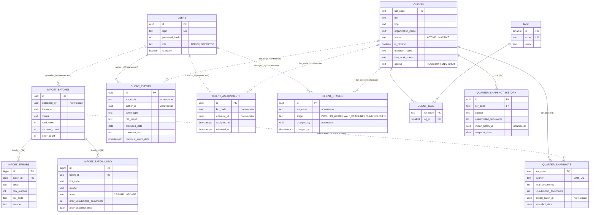

# Модель данных «Контур КЦР»

Структуры таблиц и связи для четырёх БД микросервисов (ADR-0001). PostgreSQL.
Каждый сервис владеет своей БД; **физические FK — только внутри одной БД**,
связи между БД — логические (целостность поддерживается сервисами через API).

DDL по сервисам: [`ddl/identity.sql`](ddl/identity.sql), [`ddl/clients.sql`](ddl/clients.sql),
[`ddl/import.sql`](ddl/import.sql), [`ddl/operator_work.sql`](ddl/operator_work.sql).

## Зафиксированные решения (согласовано)

| # | Решение | Следствия |
|---|---------|-----------|
| 1 | Признаки клиента — справочник `tags` + `client_tags` (M:N) | комбинации из выгрузки («VIP+Итегратор») ложатся сами; новые признаки — строка справочника, без миграций |
| 2 | Период среза — строка `quarter` (`2026_Q1`) по spec.md §2.3 | составные периоды реестра («2-4 кв 2025», «весь 2025») при импорте отсеваются в `import_errors` |
| 3 | Одна запись на (`kcr_code`, `quarter`) — актуальное состояние (upsert) **+ append-only журнал** `quarter_snapshot_history` | обязательное требование «хранение истории изменения статуса передачи документов»: каждое изменение `unsubmitted_documents` фиксируется записью журнала; на журнале считаются динамика (две последние записи последнего квартала) и «последние 3 среза» ассистента |
| 4 | Коды КЦР из среза, отсутствующие в реестре, — отсев в `import_errors` | в реестр попадают только клиенты из файла реестра |
| 5 | Закрепление и этап — таблицы Operator Work DB | атомарный `take` — транзакция одной БД; `clients` — чистый справочник (отход от буквы spec.md §2.2, согласовано) |
| 6 | Журнал импорта — отдельная Import DB | Import Service получает собственное хранилище (обновляет таблицу сервисов в README) |

## Терминология

Слова «долг», «задолженность», «должник» запрещены (spec.md §1.2). В схеме — только
«непереданные документы» (`unsubmitted_documents`). Исходные файлы содержат
«Долг» — импорт переименовывает. Значение «Долг, пнула МПП» из выгрузки
сохраняется в `clients.raw_work_status` как есть — это исходные данные,
приложение их не показывает (готовим нейтральный маппинг в UI).

## ER-диаграмма

Сплошные линии — физический FK внутри одной БД; пунктирные — логическая связь
между БД разных сервисов (проверяется приложением).

---

## Identity DB — Gateway / Identity (Go)

### `users` — spec.md §2.1

| Колонка | Тип | Ограничения |
|---------|-----|-------------|
| `id` | UUID | PK |
| `login` | TEXT | NOT NULL, UNIQUE |
| `password_hash` | TEXT | NOT NULL |
| `role` | TEXT | NOT NULL, CHECK в (`ADMIN`,`OPERATOR`) |
| `is_active` | BOOLEAN | NOT NULL DEFAULT true |
| `created_at` | TIMESTAMPTZ | NOT NULL DEFAULT now() |

Удаления нет — деактивация (`is_active = false`). В модели нет ФИО, поэтому
«имя владельца» в 409 — `login` (см. открытый вопрос в
[`docs/api/internal/gateway-identity.yaml`](../api/internal/gateway-identity.yaml)).

---

## Clients DB — Clients Service (Python)

### `clients` — реестр, spec.md §2.2 + лист «Все КЦР»

| Колонка | Тип | Ограничения / маппинг из выгрузки |
|---------|-----|-----------------------------------|
| `kcr_code` | TEXT | PK; колонка A реестра, уникальна |
| `inn` | TEXT | индекс; в тестовой выгрузке пусто, модель требует (один ИНН → несколько кодов КЦР) |
| `kpp` | TEXT | |
| `organization_name` | TEXT | «Название» |
| `status` | TEXT | CHECK в (`ACTIVE`,`INACTIVE`); «Дейсвующий»→ACTIVE, «Не действующий»→INACTIVE |
| `is_blocked` | BOOLEAN | NOT NULL DEFAULT false; «Блокировка в сервисе»: да/нет |
| `manager_name` | TEXT | «ФИО менеджера» |
| `raw_work_status` | TEXT | исходный статус колонки G («VIP+Итегратор», «Не нужно работать») — как есть, для истории и разбора маппинга |
| `source` | TEXT | NOT NULL DEFAULT `REGISTRY`, CHECK в (`REGISTRY`,`SNAPSHOT`) |
| `created_at` / `updated_at` | TIMESTAMPTZ | NOT NULL DEFAULT now() |

Закрепление и этап — **не здесь** (решение 5, Operator Work DB).

### `tags` / `client_tags` — признаки клиента (решение 1)

`tags`: `id` SMALLINT PK, `code` TEXT UNIQUE NOT NULL (`VIP`, `NOVICE`,
`INTEGRATOR`, `TECH_PARTNER`, `MPP`, `DO_NOT_WORK`), `name` TEXT.
`client_tags`: (`kcr_code` FK → clients ON DELETE CASCADE, `tag_id` FK → tags
ON DELETE RESTRICT) PK, `added_at`.

Стартовый справочник из выгрузки (парсинг `raw_work_status`):
`VIP` (203+23+5+2+1), `INTEGRATOR` («Интеграторы», «VIP+Итегратор»),
`TECH_PARTNER` («Техпартнер», «VIP, Техпартнер»), `MPP` («МПП для штрафа»,
«Общение через МПП»), `DO_NOT_WORK` («Не нужно работать»), `NOVICE` — из
бизнес-правила «новички», в выгрузке не встречается. Остальные значения статусов
(«Претензия в работе», «Ждут санкций», «IV кв 2025 в работе»...) — рабочие
состояния, остаются только в `raw_work_status`.

### `quarter_snapshots` — актуальные срезы, spec.md §2.3 (upsert, решение 3)

| Колонка | Тип | Ограничения / маппинг из среза |
|---------|-----|-------------------------------|
| `kcr_code` | TEXT | PK с `quarter`, FK → clients ON DELETE CASCADE |
| `quarter` | TEXT | PK с `kcr_code`; CHECK `^\d{4}_Q[1-4]$`; имя листа среза |
| `total_documents` | INTEGER | NOT NULL, CHECK ≥ 0; «документов всего» — фиксируется при **первой** загрузке квартала, дальше не меняется (spec.md §1.2) |
| `unsubmitted_documents` | INTEGER | NOT NULL, CHECK ≥ 0; «Всего не отправлено документов» — обновляется каждой загрузкой |
| `import_batch_id` | UUID | NOT NULL — **логическая** ссылка на Import DB (последний пакет, менявший запись) |
| `snapshot_date` | DATE | NOT NULL — дата последней загрузки |
| `created_at` / `updated_at` | TIMESTAMPTZ | NOT NULL |

Правила записи (Import Worker через API Clients Service):
- записи нет → INSERT (`total` + `unsubmitted`) **+ первая запись журнала** истории;
- запись есть → UPDATE только `unsubmitted_documents`, `import_batch_id`,
  `snapshot_date`; `total_documents` не трогаем никогда **+ запись журнала**.

### `quarter_snapshot_history` — журнал изменения статуса передачи документов

Обязательное требование (spec.md §1.2, §2.4): append-only, одна запись на каждое
изменение `unsubmitted_documents` при импорте.

| Колонка | Тип | Назначение |
|---------|-----|-----------|
| `id` | UUID | PK |
| `kcr_code` + `quarter` | TEXT | FK → clients / CHECK формата квартала |
| `unsubmitted_documents` | INTEGER | значение после изменения |
| `import_batch_id` | UUID | логическая ссылка на пакет, вызвавший изменение |
| `snapshot_date` | DATE | дата среза |
| `created_at` | TIMESTAMPTZ | когда применено |

**Расчётные определения (на журнале):**
- *динамика клиента* — две последние записи журнала последнего квартала:
  `ALL_SUBMITTED` (последняя = 0) / `REDUCING` / `NO_CHANGE` / `GROWING`;
  единственная запись в квартале → динамика не определена (жёлтый «Впервые»);
- *«последние N срезов»* для сводки ассистента — N последних записей журнала
  по `created_at DESC`;
- *откат пакета* — удаление записей журнала этого пакета + восстановление
  актуальных срезов по undo-информации (см. Import DB).

---

## Import DB — Import Worker (Python), решение 6

### `import_batches` — журнал импортов, spec.md §2.5

1 загруженный файл = 1 пакет (откат семантически «файл загружен по ошибке»).

| Колонка | Тип | Ограничения |
|---------|-----|-------------|
| `id` | UUID | PK |
| `uploaded_by` | UUID | NOT NULL — логическая ссылка на `users` |
| `filename` | TEXT | NOT NULL |
| `status` | TEXT | CHECK в (`PROCESSING`,`COMPLETED`,`ROLLED_BACK`,`FAILED`) |
| `total_rows` / `success_count` / `error_count` | INTEGER | NOT NULL DEFAULT 0 |
| `created_at` / `completed_at` | TIMESTAMPTZ | |

`error_log` из spec.md §2.5 материализован таблицей `import_errors` (решение:
нужна пагинация и выгрузка `.xlsx` с ошибками, виджет spec.md §4.1).

### `import_errors` — строки с ошибками

`id` BIGSERIAL PK, `batch_id` FK → import_batches ON DELETE CASCADE,
`sheet` TEXT, `row_number` INTEGER, `kcr_code` TEXT NULL, `reason` TEXT.

Причины из данных: нет Кода КЦР; дубликат кода внутри листа (найден `ISE83063`);
код отсутствует в реестре (решение 4); дробное значение документов; составной
период реестра (решение 2); строка «ИТОГО» (пропуск, не ошибка).

### `import_batch_undo` — undo-информация для отката (следствие upsert)

Таблица заполняется Import Worker'ом **до** применения пакета в Clients Service
и позволяет выполнить `rollback` (spec.md §3.2.3) без истории срезов:

- `action = CREATE` — пакет создал запись (`kcr_code`, `quarter`): откат →
  DELETE в Clients Service (включая записи журнала пакета);
- `action = UPDATE` — пакет обновил запись: храним `prev_unsubmitted_documents`,
  `prev_snapshot_date` (и `prev_import_batch_id`): откат → восстановление
  значений в Clients Service; записи `quarter_snapshot_history`, добавленные
  пакетом, удаляются.

---

## Operator Work DB — Operator Work Service (Python), решение 5

### `client_events` — лента событий, spec.md §2.4

| Колонка | Тип | Ограничения |
|---------|-----|-------------|
| `id` | UUID | PK |
| `kcr_code` | TEXT | NOT NULL — логическая ссылка на clients; индекс (`kcr_code`, `created_at`) |
| `author_id` | UUID | NOT NULL — логическая ссылка на users |
| `event_type` | TEXT | CHECK в (`CALL_RESULT`,`HISTORICAL_COMMENT`,`EMAIL_SENT`,`STAGE_CHANGE`,`CLAIM_UPDATE`,`OPERATOR_ASSIGN`) |
| `call_result` | TEXT | NULL; CHECK: заполнен только при `CALL_RESULT`, значения (`AGREEMENT`,`REFUSAL`,`NO_ANSWER`,`WRONG_NUMBER`) |
| `promised_date` | DATE | NULL — обещанный срок |
| `comment_text` | TEXT | NOT NULL |
| `historical_event_date` | TIMESTAMPTZ | NULL — дата в прошлом для «прошлого комментария» |
| `created_at` | TIMESTAMPTZ | NOT NULL DEFAULT now() |

Append-only: события не редактируются и не удаляются (согласовано).
«Актуальный обещанный срок» для «Сегодня нужно» — из последнего события с
непустым `promised_date`.

### `client_assignments` — закрепление за оператором

`id` UUID PK, `kcr_code` TEXT NOT NULL, `operator_id` UUID NOT NULL,
`assigned_at` TIMESTAMPTZ NOT NULL DEFAULT now(), `released_at` TIMESTAMPTZ
NULL, `released_by` UUID NULL.

Актуальное закрепление — строка с `released_at IS NULL`; частичный уникальный
индекс гарантирует максимум одно активное закрепление на клиента.
`take` = одна ACID-транзакция: попытка INSERT / SELECT FOR UPDATE при конфликте →
`409` с именем владельца (spec.md §1.2, §3.3). История закреплений остаётся.

### `client_stages` — история этапов

`id` UUID PK, `kcr_code` TEXT NOT NULL, `stage` TEXT CHECK в
(`POOL`,`IN_WORK`,`WAIT_DEADLINE`,`CLAIM`,`CLOSED`), `changed_by` UUID NOT NULL,
`changed_at` TIMESTAMPTZ NOT NULL DEFAULT now(), `comment` TEXT NULL.

Актуальный этап — последняя запись по `changed_at`. Смена этапа также пишет
событие `STAGE_CHANGE` в `client_events`; взятие в работу — `OPERATOR_ASSIGN`.

---

## Маппинг импорта: Excel → таблицы

**Реестр `КЦР_последняя выгрузка_*.xlsx`, лист «Все КЦР»** (шапка в r2 смещена
на колонку вправо от данных, данные с r3):

| Колонка листа | → таблица.колонка |
|---------------|-------------------|
| A «(код)» | `clients.kcr_code` |
| H «ИНН», I «КПП», C «Название», L «ФИО менеджера» | `clients.inn/kpp/organization_name/manager_name` |
| J «Действует ли КЦР» | `clients.status` (маппинг с опечаткой «Дейсвующий») |
| K «Блокировка в сервисе» | `clients.is_blocked` |
| G «статус на …» | `clients.raw_work_status` + парсинг в `client_tags` |
| O..BN «Долг … на дату», «Всего документов …» | **не импортируются**: агрегаты; «Долг» — запрещённый термин; актуальные значения приходят файлами срезов |

**Срез `Срез …_Дубна.xlsx`** (лист = квартал):

| Колонка листа | → таблица.колонка |
|---------------|-------------------|
| A «Уникальный обезличенный идентификатор» | `quarter_snapshots.kcr_code` |
| имя листа («1 кв 2026») | `quarter_snapshots.quarter` = `2026_Q1` |
| D «документов всего» | `total_documents` (только при первой загрузке квартала) |
| E «Всего не отправлено документов» | `unsubmitted_documents` |
| дата из имени файла («Срез 20.10.26») | `snapshot_date` |

Валидация до применения: отсев «ИТОГО», строк без кода, дубликатов внутри листа,
кодов вне реестра (решение 4), дробных значений (округление — открытый вопрос);
итог — `import_batches` счётчики + `import_errors` строки.
